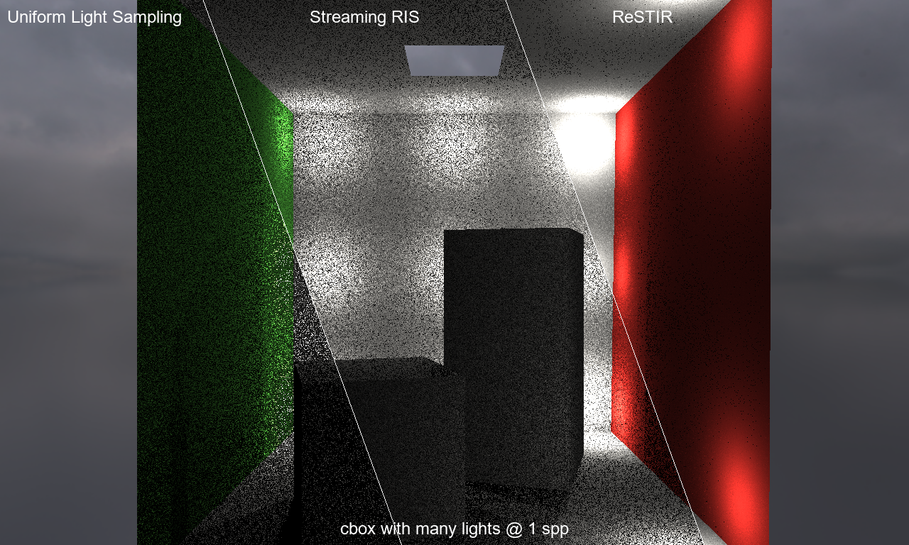
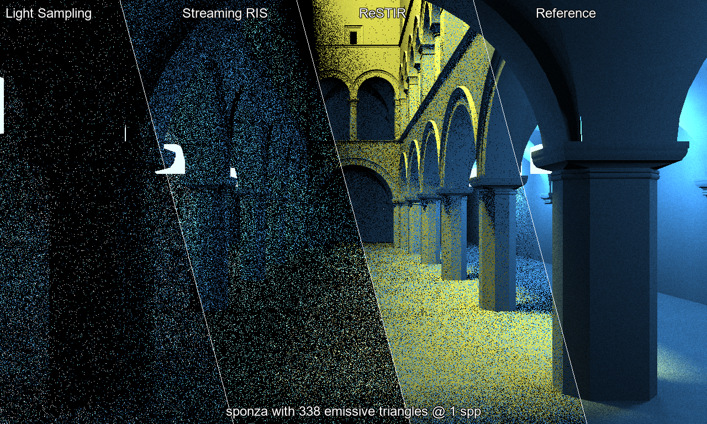

# Realtime Rendering Course at KIT (Winterterm 2024/25)
## Assignment 4 - ReSTIR
As part of the Realtime Rendering Course we implement the [ReSTIR](https://research.nvidia.com/sites/default/files/pubs/2020-07_Spatiotemporal-reservoir-resampling/ReSTIR.pdf) algorithm.



The algorithm reduces noise in direct illumination by an order of magnitude compared to our Streaming RIS and uniform light sampling implementations. Our algorithms are implemented in the `Assignments/Assignment4` directory.

## Framework `glf`
The `glf` framework is property of the computer graphics group at KIT.

## Setup
Run the setup-msvc.bat script to configure the project and open the sln in VS. For convenience the shaders are opened in VS Code. 

## Settings
### Select Algorithm
Change the algorithm used for sampling direct illumination by changing the `renderSettings.sampleMode` variable in the assignment4.cpp file to one of the following:
- SAMPLE_MODE_UNIFORM
- SAMPLE_MODE_RIS
- SAMPLE_MODE_STREAMING_RIS
- SAMPLE_MODE_RESTIR

Or use th GUI to change this while the application is running.

### ReSTIR Settings

| Parameter                     | Description                                                                 | Default Value | Value Range       |
|-------------------------------|-----------------------------------------------------------------------------|---------------|-------------------|
| Last Frame Contribution Weight` | Weighting of accumulated previous samples. Higher value increases temporal stability but might cause ghosting. | 20            | 0 - 100           |
| Spatial Reuse Samples     | Number of neighbouring reservoirs to reuse.                                 | 5             | 0 - 10            |
| Neighborhood Size           | Size of the neighborhood square.                                            | 30            | 1 - 100           |
| Threshold Albedo            | Albedo difference threshold for reuse.                                      | 0.1           | 0.0 - 1.0         |
| Threshold Normal            | Normal difference threshold in degrees.                                     | 25.0          | 0.0 - 180.0       |
| Threshold Position          | Relative position difference threshold.                                     | 0.1           | 0.0 - 1.0         |
| Spatial Iterations          | Number of iterations for spatial sample reuse threshold.                                     | 2           | 1 - 5         |

### Scene Selection
Select different scenes to render in the assignment4.cpp file by changing the index:
```c++
[87] const vector<string> scene_names = { "cbox.obj", 
                                          "cbox-light.obj", 
                                          "cbox-light-many.obj", 
                                          "cbox-torus.obj", 
                                          "sponza-many.obj" };
[88] const uint scene_idx = 2;
```



### Screen Captures
Screen captrues in PNG and PFM format can be created by adding the frame indices to captrue in the assignment4.cpp file:
```c++
[85] static std::vector<int> frames_to_capture = {1,2,10,50};
```
Alternatively, use the keybind `C` to capture the image that is currently displayed.